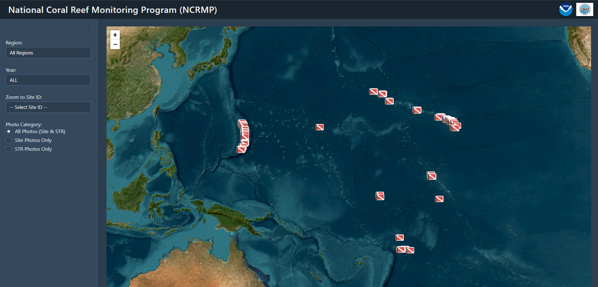

# PIFSC ESD ARP OCC Sitemap
- Developed as a resource to view OCC sites quickly for planning purposes and make use of existing site photo data.


* **Multi-Attribute Filtering:**
  * **Filter by Region:** Narrow down site markers by geographic region (e.g., CNMI, American Samoa / PRIA, Main Hawaiian Islands).
  * **Filter by Fiscal Year:** View sites corresponding to specific project cycles (`FY25`, `FY26`, `FY27`).
  * **Filter by Photo Category:** Toggle between **Site Photos** (broad substrate/site overviews) and **STR Photos** (Subsurface Temperature Recorder equipment photos).
* **Direct Site Navigation & Zoom:**
  * **Zoom to Site ID:** Select any specific `OCC_SITEID` from a searchable dropdown menu to immediately center and zoom the map directly to that site's coordinates.
* **Interactive Map Markers:**
  * **Custom Dive Flag Icons:** Sites are displayed using custom dive flag markers.
  * **International Date Line Handling:** Custom longitude wrapping logic ensures seamless marker rendering across negative/positive longitudes near the IDL.
* **Site Metadata Popups:**
  * Click any dive flag marker to open a detailed popup displaying `Site ID`, `Location Name`, `Depth (m)`, `Fiscal Year`, and thumbnail previews of associated photos.
* **Full-Screen Lightbox Photo Gallery:**
  * Clicking any photo thumbnail opens an interactive lightbox modal overlay.
  * **High-Resolution Inspection:** View full-sized images directly within the browser interface.
  * **Keyboard & Touch Navigation:** Cycle through site photos using keyboard arrow keys (`LeftArrow` / `RightArrow`) or close the view with `Escape`. Includes photo counters and metadata headers.

---
- **Output:**
  - **Interactive Map (`map_out`):** A Folium/Esri World Imagery satellite map rendered in Shiny for Python featuring custom dive flag markers with wrapped longitude coordinates across the International Date Line.
  - **Site Detail Popups:** Interactive map popups presenting site metadata (`Site ID`, `Location`, `Depth`, `Year`) alongside thumbnail galleries.
  - **Full-Screen Lightbox Gallery:** An embedded JavaScript/CSS overlay modal allowing high-resolution photo viewing, image counter titles, modal controls, and keyboard navigation (`ArrowLeft`, `ArrowRight`, `Escape`).

## Prerequisites
- Python 3.8+
- Python Packages:
  - `shiny`
  - `pandas`
  - `folium`

## Installing
1. Clone the repository:
   ```bash
   git clone https://github.com/LoriLuers-PIFSC/esd-occ-sitemap.git
   cd esd-occ-sitemap
   ```

2. Install required dependencies:
   ```bash
   pip install shiny pandas folium
   ```

3. Run the Shiny app:
   ```bash
   shiny run app.py
   ```

## Resources
- Related metadata for this ESA project is described here: https://www.fisheries.noaa.gov/inport/item/76360

## Contact
- primary point of contact: Zach Taylor
- secondary contact: Lori Luers

## Version Control Platform
- Git

## License
See the [LICENSE.md](./LICENSE.md) for details

## Disclaimer
This repository is a scientific product and is not official communication of the National Oceanic and Atmospheric Administration, or the United States Department of Commerce. All NOAA GitHub project code is provided on an ‘as is’ basis and the user assumes responsibility for its use. Any claims against the Department of Commerce or Department of Commerce bureaus stemming from the use of this GitHub project will be governed by all applicable Federal law. Any reference to specific commercial products, processes, or services by service mark, trademark, manufacturer, or otherwise, does not constitute or imply their endorsement, recommendation or favoring by the Department of Commerce. The Department of Commerce seal and logo, or the seal and logo of a DOC bureau, shall not be used in any manner to imply endorsement of any commercial product or activity by DOC or the United States Government.
